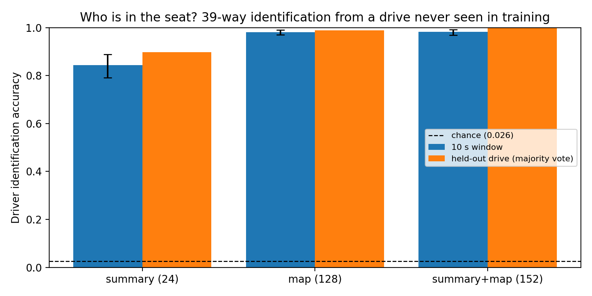
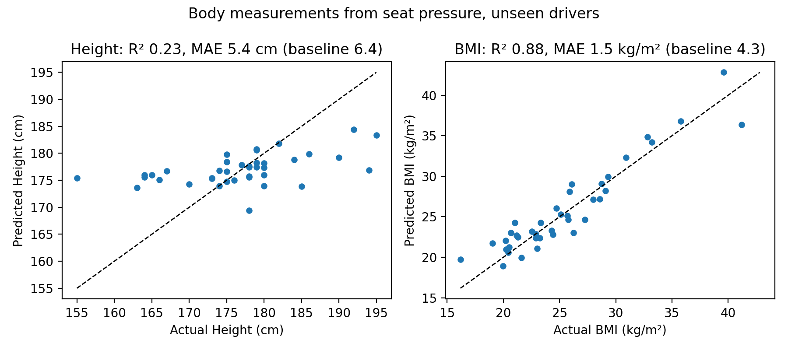
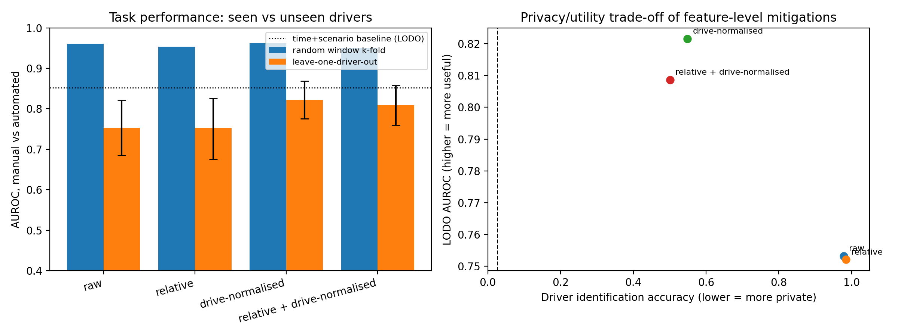
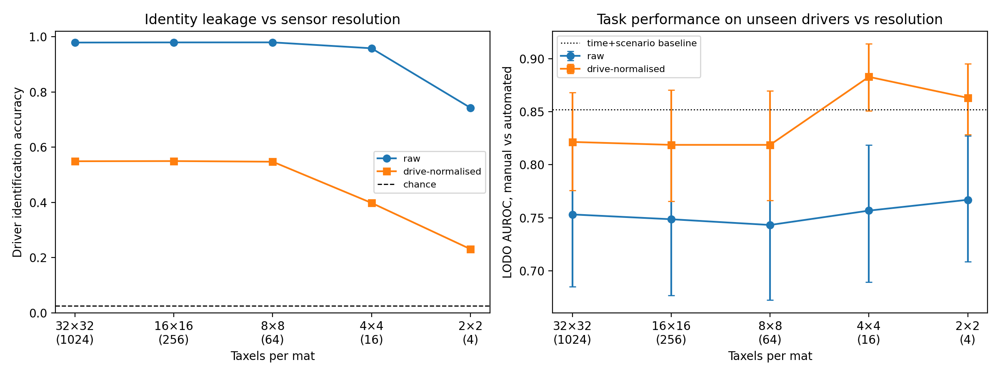
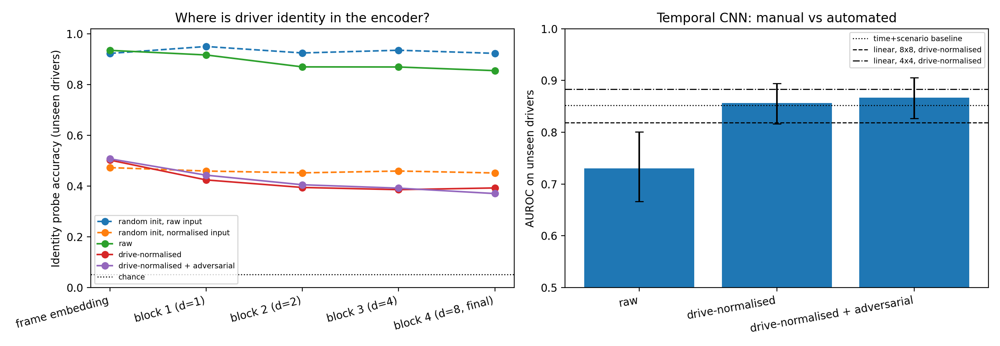

# Who Is in the Seat?
### Identity Leakage and Cross-Driver Generalisation in Automotive Seat-Pressure Sensing

Tactile sensing in the driver's seat is often described as privacy-preserving because it is not a camera. This project tests that claim on real driving-simulator data and asks what it means for driver-state models that must work on people they have never seen.

Using seat and backrest pressure alone from 39 drivers, the project measures four things:

- how strongly the pressure field identifies the driver and reveals their body measurements;
- how much that identity signal inflates conventional evaluation;
- whether simple mitigations and lower sensor resolution make a model both more private and better on new drivers;
- whether the resulting model is small and fast enough for in-vehicle hardware.

No camera, eye-tracking or physiological signal is used as input or label anywhere.

## Key findings

| | Result |
|---|---|
| **Re-identification** | 10 s of seat and backrest pressure identifies the driver among 39 with **98.2%** accuracy on a drive never seen in training (chance 2.6%). A majority vote over each drive identifies **176 of 176** drives. |
| **Identity is in the raw signal** | A randomly initialised, untrained network already reaches **92%** identity probe accuracy on unseen drivers. |
| **Body leakage** | BMI is predicted for unseen drivers with **R² = 0.88** (MAE 1.5 kg/m², against 4.3 for a mean-only baseline). |
| **Optimism gap** | For manual vs automated driving, AUROC of **0.96** under random window k-fold falls to **0.75** on unseen drivers. |
| **Mitigation** | Normalising each drive against its first 60 s cuts identification from 98% to 55% and **raises** unseen-driver AUROC by **+0.068** (paired bootstrap 95% CI +0.018 to +0.119, p = 0.003). |
| **Sensor resolution** | At **4×4 taxels per mat** with normalisation, identification falls to 40% while unseen-driver AUROC rises to **0.883**. Identity degrades faster than the task as resolution drops. |
| **Edge deployment** | A 58k-parameter temporal CNN quantised to static INT8 is **76 KB**, runs in **1.0 ms** per 10 s window on one CPU thread, and loses only 0.005 AUROC. |

## Data

**manD 1.0** is a multimodal driving-simulator dataset from TU Dortmund, published in *Scientific Data* (2024): https://www.nature.com/articles/s41597-024-03137-y
The data is on Harvard Dataverse (doi:10.7910/DVN/SG9TMD) under CC BY 4.0.

- **Drivers:** the 39 participants without motion sickness, using all 176 of their main drives with seat pressure.
- **Inputs:** BodiTrak seat and backrest mats, 32×32 each, giving 7,558 non-overlapping 10 s windows.
- **Task label:** the simulator's `AutomationMode`, manual (0) vs automated Level 2/3 (2, 3).
- **Body measurements:** height and BMI from the participant sheet.

The notebook downloads the data directly from Dataverse. No data is redistributed in this repository.

### Data audit findings
Building the dataset surfaced four properties of manD's seat data that matter to anyone using it:

1. **Update rate.** The documented rate is 15 Hz, stored at 256 Hz. The measured rate of distinct frames was about 8 Hz for the seat and 11 Hz for the backrest.
2. **Sensor ceiling.** Values are integers from 0 to 200. On average 20% of seat cells sit at the ceiling, ranging from 2% to 48% across drives. Saturation itself tracks body size (Spearman ρ = 0.62 with BMI).
3. **Filled frames.** About 5% of backrest frames per drive appear in the authors' `zero_time_values` log. These frames contain values rather than zeros, which identifies them as filled copies, so they are excluded.
4. **Missing logs and gaps.** P48 and P50 ship without a copied-frame log. Three drives contain short recording gaps, at most 0.05% of frames, which are flagged and excluded.

## Methods

The analysis plan, including hypotheses, splits, metrics and decision rules, was fixed before any model was trained.

**Preprocessing.** Both mats are resampled to a fixed 8 Hz sample-and-hold grid. Drives are split into non-overlapping 10 s windows, keeping a window only if at least 90% of its frames are valid. A task label is assigned only when at least 90% of a window's frames share one mode.

**Features.** There are 24 summary features covering load, contact area, saturation, centre-of-pressure position and sway, path length, postural shift rate, micro-movement and left-right asymmetry for each mat. These are combined with 8×8 mean pressure maps of each mat.

**Evaluation.**
- **Identity:** 39-way identification of a held-out drive, with folds by drive index so no drive appears in both training and test.
- **Task, linear and gradient-boosting models:** leave-one-driver-out (LODO).
- **Task, neural models:** grouped 5-fold by driver.
- **Uncertainty:** 95% confidence intervals from 1,000 driver-level bootstrap resamples.

| | Question | Method |
|---|---|---|
| E1 | Is driver identity decodable? | Logistic regression on features; drive-level label permutation test |
| E2 | Are body measurements decodable? | LODO ridge regression on drive-averaged features, with alpha tuned by grouped inner CV |
| E3 | Does identity inflate evaluation, and can it be mitigated? | k-fold vs LODO; relative pressure, per-drive normalisation against the first 60 s, adversarial identity removal |
| E4 | How does sensor resolution trade privacy against utility? | Block-averaging to 16×16, 8×8, 4×4 and 2×2 |
| E5 | Can it run on in-vehicle hardware? | Static INT8 quantisation (PyTorch FX), single-thread CPU latency |

**Neural model.** A dilated temporal CNN with about 58k parameters, taking 8×8 pooled frames from both mats. Each frame passes through a linear embedding, then four residual dilated Conv1d blocks with dilations 1, 2, 4 and 8. Every model was trained with 3 seeds for 25 epochs, with no tuning on test drivers. The adversarial variant adds gradient reversal against an identity head.

**Identity probes.** For the layer-wise probes, the encoder is trained on one half of the drivers and probed on the other half, so probed drivers are never seen in training. Randomly initialised networks serve as controls.

## Results

### E1: Driver identification (held-out drive, 39 drivers, chance 0.026)

| Features | Window accuracy [95% CI] | Held-out drives identified |
|---|---|---|
| Summary (24) | 0.843 [0.792, 0.888] | 0.898 |
| Maps (128) | 0.981 [0.970, 0.990] | 0.989 |
| Summary + maps (152) | 0.982 [0.969, 0.992] | 1.000 (176/176) |

The permutation test used 100 drive-level label shuffles. The null distribution had a mean of 0.026 and a maximum of 0.056, giving p = 0.0099.



### E2: Body measurements of unseen drivers

| Target | R² | MAE | Mean-only MAE | Permutation p |
|---|---|---|---|---|
| BMI | 0.881 | 1.5 kg/m² | 4.3 kg/m² | 0.0099 |
| Height | 0.235 | 5.4 cm | 6.4 cm | 0.0099 |



### E3: Optimism gap and mitigations (manual vs automated)

| Model | Identity acc. | k-fold AUROC | LODO AUROC [95% CI] | Gap |
|---|---|---|---|---|
| Linear, raw | 0.979 | 0.961 | 0.753 [0.685, 0.822] | +0.208 |
| Linear, relative pressure | 0.984 | 0.954 | 0.752 [0.675, 0.827] | +0.202 |
| Linear, drive-normalised | 0.549 | 0.962 | 0.822 [0.776, 0.868] | +0.140 |
| Linear, relative + drive-normalised | 0.501 | 0.951 | 0.809 [0.760, 0.858] | +0.142 |
| Gradient boosting, raw | | 0.997 | 0.790 [0.729, 0.848] | +0.207 |

Paired driver-level bootstrap, drive-normalised minus raw: ΔAUROC = +0.068 [+0.018, +0.119], one-sided p = 0.003.



### E4: Sensor resolution (linear models, LODO)

| Taxels per mat | Identity, raw | Identity, normalised | AUROC, raw | AUROC, normalised [95% CI] |
|---|---|---|---|---|
| 32×32 (1024) | 0.979 | 0.549 | 0.753 | 0.822 [0.776, 0.868] |
| 16×16 (256) | 0.979 | 0.550 | 0.749 | 0.819 [0.766, 0.870] |
| 8×8 (64) | 0.979 | 0.547 | 0.743 | 0.819 [0.766, 0.870] |
| 4×4 (16) | 0.958 | 0.398 | 0.757 | **0.883 [0.851, 0.914]** |
| 2×2 (4) | 0.743 | 0.231 | 0.767 | 0.863 [0.829, 0.895] |



### Neural model: task performance and identity probes

| Variant | AUROC, unseen drivers [95% CI] | Per-seed AUROC |
|---|---|---|
| Raw input | 0.731 [0.667, 0.801] | 0.717, 0.723, 0.719 |
| Drive-normalised | 0.856 [0.816, 0.894] | 0.836, 0.839, 0.843 |
| Drive-normalised + adversarial | 0.867 [0.827, 0.905] | 0.840, 0.841, 0.851 |

| Identity probe (chance 0.051) | Frame embedding | Final layer |
|---|---|---|
| Random init, raw input | 0.923 | 0.923 |
| Random init, normalised input | 0.473 | 0.452 |
| Trained, raw | 0.935 | 0.855 |
| Trained, drive-normalised | 0.502 | 0.393 |
| Trained, drive-normalised + adversarial | 0.507 | 0.371 |

### E5: INT8 deployment (static INT8, FX graph mode, one CPU thread)

| | AUROC | Size | Median latency per 10 s window |
|---|---|---|---|
| FP32 | 0.8395 | 239 KB | 1.410 ms |
| INT8 | 0.8349 | 76 KB | 1.031 ms |

Quantisation gives a 3.1× smaller model and a 1.37× speed-up for an AUROC change of −0.0047.



## Reproducing

The notebook runs on Kaggle with Internet enabled. A GPU is optional and is used only by the neural cell. Run the cells in order:

1. **Setup and format check.** Confirms the licence and file list, and checks the seat-file layout on one drive.
2. **Dataset build.** Downloads each driver's archive, extracts the seat, copied-frame and vehicle files, and stores each drive as a compressed 8 Hz uint8 array. This takes about 80 minutes.
3. **Recording gaps.** Rebuilds drives with recording gaps flagged frame by frame, with the copied-frame log treated as optional.
4. **Windows, features, E1 and E2.**
5. **E3:** k-fold vs LODO, and the mitigations.
6. **E4:** the resolution sweep and the paired test.
7. **Neural models:** task performance, identity probes, adversarial training and E5.

Requirements: Python 3, numpy, pandas, pyarrow, scipy, scikit-learn, matplotlib, openpyxl, torch, and the `7z` command-line tool. Results are written to `results/*.json` and figures to `figures/`.

## Repository structure
```
Who-Is-In-The-Seat/
├── README.md
├── LICENSE
├── who_is_in_the_seat.ipynb
├── figures/
│   ├── e1_identity.png
│   ├── e2_body.png
│   ├── e3_confound.png
│   ├── e4_resolution.png
│   └── e3e5_neural.png
└── results/
    ├── e1_e2.json
    ├── e3.json
    ├── e4.json
    └── neural.json
```

## Licence and attribution
The code is released under the MIT licence. The data belongs to the manD 1.0 authors and is used under CC BY 4.0. Please cite their *Scientific Data* paper and the Dataverse record if you use it.

## Author
Harshith Reddy Aila · [github.com/Harie1316](https://github.com/Harie1316)
